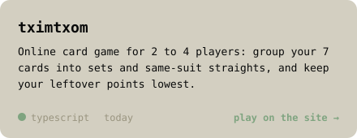

  

  

    
   

  <a href="https://badjuice.github.io/">badjuice.github.io</a> ·
  <a href="https://badjuice.github.io/tximtxom/">play TximTxom</a> ·
  <a href="https://github.com/badjuice?tab=repositories">all repositories</a>

<!-- Generated by tools/render.mjs. Edit that file, not this one. -->
