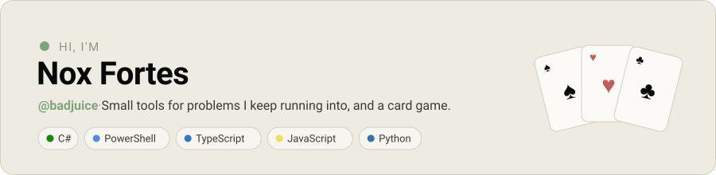
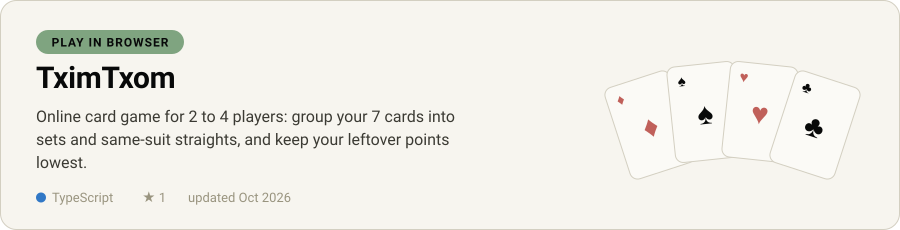
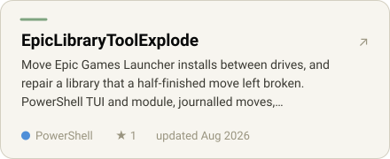
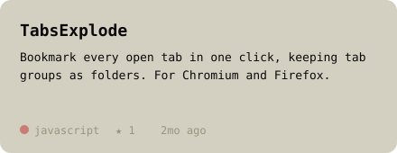
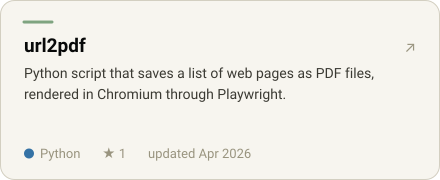
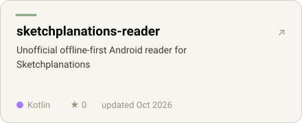
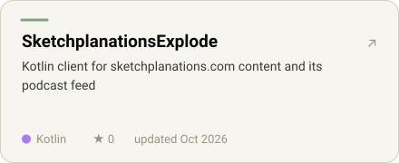
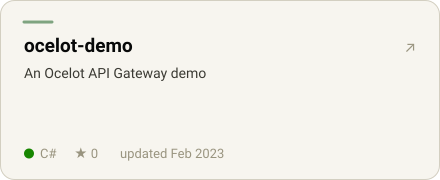
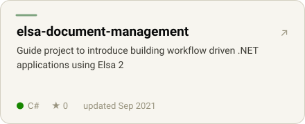

<a href="https://badjuice.github.io/"><picture><source media="(prefers-color-scheme: dark)" srcset="assets/header-dark.svg"></picture></a>

<a href="https://github.com/badjuice/tximtxom"><picture><source media="(prefers-color-scheme: dark)" srcset="assets/featured-dark.svg"></picture></a>

  <a href="https://badjuice.github.io/tximtxom/"><picture><source media="(prefers-color-scheme: dark)" srcset="assets/play-dark.svg"></picture></a>&nbsp;
  <a href="https://github.com/badjuice/tximtxom"><picture><source media="(prefers-color-scheme: dark)" srcset="assets/source-dark.svg"></picture></a>

### Projects

  <a href="https://github.com/badjuice/EpicLibraryToolExplode"><picture><source media="(prefers-color-scheme: dark)" srcset="assets/card-EpicLibraryToolExplode-dark.svg"></picture></a> <a href="https://github.com/badjuice/TabsExplode"><picture><source media="(prefers-color-scheme: dark)" srcset="assets/card-TabsExplode-dark.svg"></picture></a> 
  <a href="https://github.com/badjuice/url2pdf"><picture><source media="(prefers-color-scheme: dark)" srcset="assets/card-url2pdf-dark.svg"></picture></a> <a href="https://github.com/badjuice/sketchplanations-reader"><picture><source media="(prefers-color-scheme: dark)" srcset="assets/card-sketchplanations-reader-dark.svg"></picture></a> 
  <a href="https://github.com/badjuice/SketchplanationsExplode"><picture><source media="(prefers-color-scheme: dark)" srcset="assets/card-SketchplanationsExplode-dark.svg"></picture></a> <a href="https://github.com/badjuice/ocelot-demo"><picture><source media="(prefers-color-scheme: dark)" srcset="assets/card-ocelot-demo-dark.svg"></picture></a> 
  <a href="https://github.com/badjuice/elsa-document-management"><picture><source media="(prefers-color-scheme: dark)" srcset="assets/card-elsa-document-management-dark.svg"></picture></a> <a href="https://github.com/badjuice/fsck_you"><picture><source media="(prefers-color-scheme: dark)" srcset="assets/card-fsck_you-dark.svg"></picture></a>

  <a href="https://badjuice.github.io/">badjuice.github.io</a> ·
  <a href="https://badjuice.github.io/tximtxom/">play TximTxom</a> ·
  <a href="https://github.com/badjuice?tab=repositories">all repositories</a>

<!-- Generated by tools/render.mjs. Edit that file, not this one. -->
